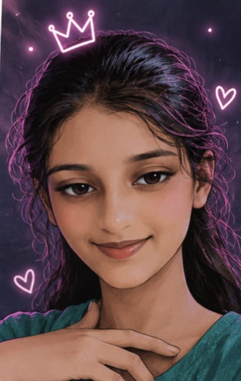
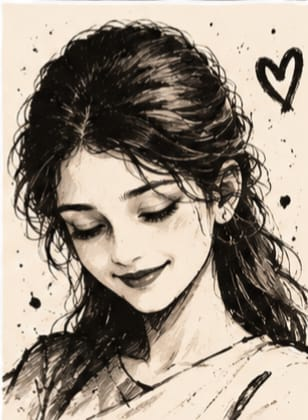
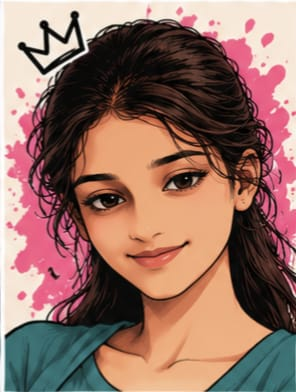
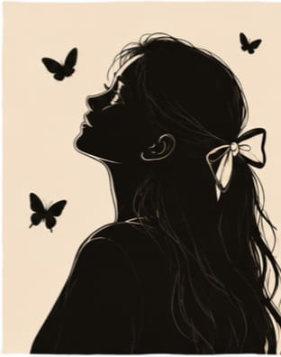
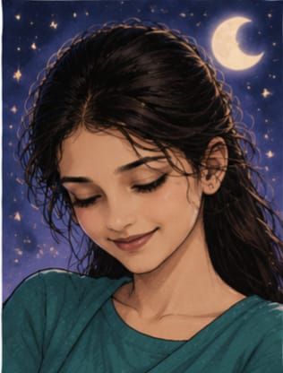
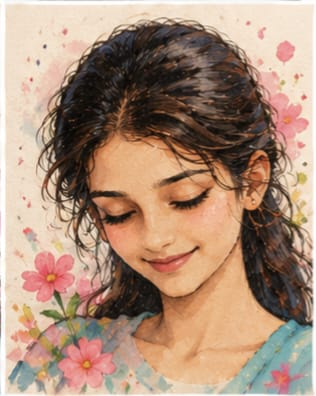
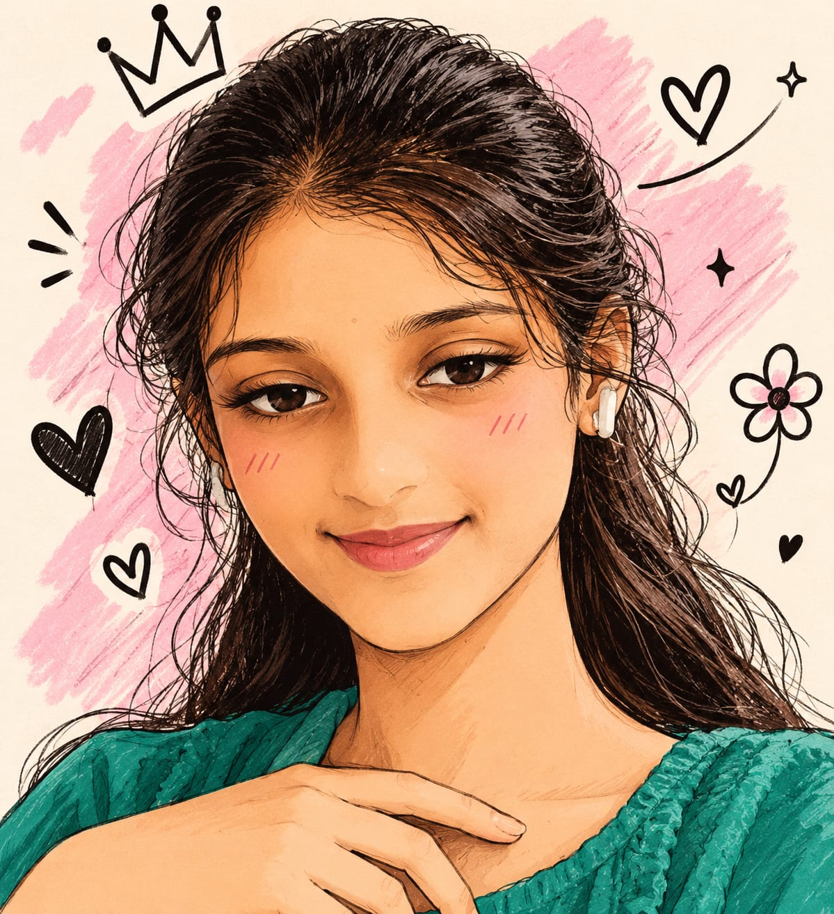

<!DOCTYPE html>
<html lang="en" class="h-full">
<head>
    <meta charset="UTF-8">
    <meta name="viewport" content="width=device-width, initial-scale=1.0">
    <title>Happy Birthday Sri Lakshmi!</title>
    <!-- Tailwind CSS CDN -->
    
    <!-- FontAwesome CDN -->
    <link rel="stylesheet" href="https://cdnjs.cloudflare.com/ajax/libs/font-awesome/6.4.0/css/all.min.css">
    <!-- Google Fonts -->
    <link rel="preconnect" href="https://fonts.googleapis.com">
    <link rel="preconnect" href="https://fonts.gstatic.com" crossorigin>
    <link href="https://fonts.googleapis.com/css2?family=Cinzel:wght@600;700;800;900&family=Great+Vibes&family=Montserrat:wght@300;400;500;600;700&family=Playfair+Display:ital,wght@0,400;0,600;1,400&display=swap" rel="stylesheet">
    <!-- Canvas Confetti CDN -->
    

    

    
</head>
<body class="min-h-screen flex flex-col justify-between relative">

    <canvas id="particleCanvas" class="fixed inset-0 pointer-events-none z-0"></canvas>
    <canvas id="fireworksCanvas" class="fixed inset-0 pointer-events-none z-40"></canvas>

    

    <audio id="bgAudio" loop preload="auto">
        <source src="https://raw.githubusercontent.com/krishnatejap76-arch/birtdaysurprise/d7c5117e5452b0195f9507b698e96a8d880b4e65/Happy%20Instrumental%20Background%20Music%20for%20Video%20and%20Presentations%20-%20Paradise%20City%20-%20Basspartout%20-%20Instrumental%20Background%20Music.mp3" type="audio/mp3">
    </audio>

    <header id="appHeader" class="hidden fixed top-0 left-0 right-0 z-50 px-6 py-4 flex justify-between items-center backdrop-blur-md bg-opacity-40 bg-black border-b border-yellow-500/20">
        

            SRI LAKSHMI
            Birthday Edition
        

        
        

            <button id="musicToggleBtn" onclick="toggleAudio()" class="w-10 h-10 rounded-full glass-card flex items-center justify-center text-yellow-400 hover:text-yellow-200 transition-all hover:scale-105 active:scale-95" title="Toggle Music">
                <i id="musicIcon" class="fas fa-music text-lg"></i>
            </button>
            
            

                Page 1 / 12
            

        

    </header>

    <main class="relative z-10 flex-grow flex items-center justify-center p-4 md:p-8 min-h-screen">

        <!-- PAGE 1: SECRET UNLOCKING GATE -->
        <section id="page1" class="page-section active flex-col items-center justify-center text-center max-w-xl w-full my-auto py-12">
            

                

                

                
                

                    <i class="fas fa-lock text-3xl"></i>
                

                <h1 class="font-cinzel text-2xl md:text-3xl font-bold tracking-wider mb-2 gold-gradient-text">
                    A SPECIAL SURPRISE AWAITS
                </h1>
                

                    Enter the secret passkey to unlock the magical celebration created just for you.
                

                <form onsubmit="handleSecretSubmit(event)" class="space-y-6">
                    

                        <input type="password" id="secretInput" placeholder="Enter Secret Word..." 
                            class="w-full px-6 py-4 rounded-full bg-black/60 border-2 border-yellow-500/40 text-center text-lg text-yellow-200 placeholder-pink-300/40 focus:outline-none focus:border-yellow-400 transition-all font-mono shadow-inner"
                            autocomplete="off">
                        

                            <i class="fas fa-exclamation-circle mr-1"></i> Incorrect secret word! Hint: Passkey starts with 'M'
                        

                    

                    <button type="submit" 
                        class="w-full py-4 rounded-full bg-gradient-to-r from-yellow-600 via-amber-500 to-yellow-600 text-slate-950 font-bold font-cinzel text-lg tracking-widest shadow-lg hover:shadow-yellow-500/50 hover:scale-[1.02] active:scale-[0.98] transition-all duration-300 flex items-center justify-center space-x-2">
                        UNLOCK SURPRISE
                        <i class="fas fa-key"></i>
                    </button>
                </form>

                

                    <i class="fas fa-heart text-pink-500 mr-1"></i> Designed exclusively for Sri Lakshmi
                

            

        </section>

        <!-- PAGE 2: GRAND WELCOME -->
        <section id="page2" class="page-section flex-col items-center justify-center text-center max-w-3xl w-full my-auto py-12">
            

                

                    <i class="fas fa-crown"></i>
                

                
                <h2 class="font-cinzel text-xl md:text-2xl text-yellow-300 tracking-widest uppercase mb-2">
                    Warmest Birthday Greetings
                </h2>
                
                <h1 class="font-greatVibes text-5xl md:text-7xl lg:text-8xl gold-gradient-text mb-6 py-2 leading-tight">
                    Happy Birthday Sri Lakshmi!
                </h1>
                
                

                    "May your day be filled with radiant joy, endless smiles, elegance, and moments as exceptionally beautiful as you are."
                

                

                    <i class="fas fa-sparkles text-yellow-400 mr-1.5"></i>Elegance
                    <i class="fas fa-star text-yellow-400 mr-1.5"></i>Grace
                    <i class="fas fa-heart text-pink-400 mr-1.5"></i>Happiness
                

                

                    <button onclick="nextPage()" class="px-8 py-3.5 rounded-full bg-gradient-to-r from-pink-600 to-rose-700 hover:from-pink-500 hover:to-rose-600 text-white font-semibold tracking-wider shadow-lg hover:shadow-pink-500/30 transition-all hover:scale-105 active:scale-95 inline-flex items-center space-x-3">
                        Proceed to the Cake Ceremony
                        <i class="fas fa-arrow-right"></i>
                    </button>
                

            

        </section>

        <!-- PAGE 3: LUXURY BIRTHDAY CAKE -->
        <section id="page3" class="page-section flex-col items-center justify-center text-center max-w-3xl w-full my-auto py-8">
            

                <h2 class="font-cinzel text-2xl md:text-3xl font-bold gold-gradient-text mb-2">
                    LUXURY BIRTHDAY CAKE
                </h2>
                

                    <i class="fas fa-microphone text-yellow-400 mr-1"></i> Blow into your microphone or tap the candles below to extinguish them!
                

                

                    

                        

                            

                                

                                

                            

                            

                                

                                

                            

                            

                                

                                

                            

                        

                        <!-- TIER 1 (TOP TIER WITH TEXT "HAPPY BIRTHDAY LUCKY") -->
                        

                            

                                

                                

                                

                                

                                

                                

                            

                            
                            <!-- TOP SURFACE TEXT -->
                            

                                Happy Birthday 
                                LUCKY
                            

                            

                                
                                
                                
                                
                                
                            

                        

                        <!-- TIER 2 -->
                        

                            

                                

                                

                                

                                

                            

                            

                                <i class="fas fa-spa"></i>
                            

                            

                                <i class="fas fa-spa"></i>
                            

                        

                        <!-- TIER 3 -->
                        

                            

                                ✦✧✦✧✦✧✦
                            

                            

                                <i class="fas fa-seedling"></i>
                            

                            

                                <i class="fas fa-seedling"></i>
                            

                        

                        

                        

                    

                

                

                    <button id="blowCandlesBtn" onclick="blowAllCandles()" 
                        class="px-6 py-3 rounded-full bg-gradient-to-r from-yellow-500 to-amber-600 hover:from-yellow-400 hover:to-amber-500 text-slate-950 font-bold font-cinzel text-sm tracking-widest shadow-lg hover:scale-105 active:scale-95 transition-all">
                        <i class="fas fa-wind mr-2"></i> BLOW OUT CANDLES
                    </button>
                    <button id="micPermissionBtn" onclick="initMicDetection()" 
                        class="px-6 py-3 rounded-full glass-card border border-yellow-500/40 text-yellow-300 text-xs font-mono hover:bg-yellow-500/10 transition-all">
                        <i class="fas fa-microphone mr-2"></i> Enable Mic Blow Detection
                    </button>
                

                

                    <button onclick="nextPage()" class="px-8 py-3.5 rounded-full bg-gradient-to-r from-pink-600 to-rose-700 hover:from-pink-500 hover:to-rose-600 text-white font-semibold tracking-wider shadow-lg hover:shadow-pink-500/30 transition-all hover:scale-105 active:scale-95 inline-flex items-center space-x-3 animate-pulse">
                        Explore Photo Showcase
                        <i class="fas fa-arrow-right"></i>
                    </button>
                

            

        </section>

        <!-- PAGE 4: PHOTO SHOWCASE 1 -->
        <section id="page4" class="page-section flex-col items-center justify-center max-w-4xl w-full my-auto py-8">
            

                

                    Solo Gallery 01
                    <h2 class="font-cinzel text-2xl md:text-4xl font-bold gold-gradient-text mt-1">A Collection of Beautiful Clicks</h2>
                

                

                    

                        

                            
                        

                        
"Some pictures don't need filters to shine."

                    

                    

                        

                            
                        

                        
"A beautiful click deserves a beautiful frame."

                    

                

                

                    <button onclick="prevPage()" class="px-5 py-2.5 rounded-full glass-card border border-yellow-500/30 text-yellow-300 text-xs hover:bg-yellow-500/10">
                        <i class="fas fa-arrow-left mr-2"></i> Previous
                    </button>
                    <button onclick="nextPage()" class="px-6 py-2.5 rounded-full bg-gradient-to-r from-pink-600 to-rose-700 text-white text-xs font-semibold tracking-wider hover:scale-105 transition-all">
                        Next Surprise <i class="fas fa-arrow-right ml-2"></i>
                    </button>
                

            

        </section>

        <!-- PAGE 5: PHOTO SHOWCASE 2 -->
        <section id="page5" class="page-section flex-col items-center justify-center max-w-4xl w-full my-auto py-8">
            

                

                    Solo Gallery 02
                    <h2 class="font-cinzel text-2xl md:text-4xl font-bold gold-gradient-text mt-1">Every Picture Has Its Own Magic</h2>
                

                

                    

                        

                            
                        

                        
"Every picture tells its own little story."

                    

                    

                        

                            
                        

                        
"That smile makes the moment special."

                    

                

                

                    <button onclick="prevPage()" class="px-5 py-2.5 rounded-full glass-card border border-yellow-500/30 text-yellow-300 text-xs hover:bg-yellow-500/10">
                        <i class="fas fa-arrow-left mr-2"></i> Previous
                    </button>
                    <button onclick="nextPage()" class="px-6 py-2.5 rounded-full bg-gradient-to-r from-pink-600 to-rose-700 text-white text-xs font-semibold tracking-wider hover:scale-105 transition-all">
                        Next Surprise <i class="fas fa-arrow-right ml-2"></i>
                    </button>
                

            

        </section>

        <!-- PAGE 6: PHOTO SHOWCASE 3 -->
        <section id="page6" class="page-section flex-col items-center justify-center max-w-4xl w-full my-auto py-8">
            

                

                    Solo Gallery 03
                    <h2 class="font-cinzel text-2xl md:text-4xl font-bold gold-gradient-text mt-1">Elegance in Every Frame</h2>
                

                

                    

                        

                            
                        

                        
"Elegance captured in a single frame."

                    

                    

                        

                            
                        

                        
"A little sparkle in every picture."

                    

                

                

                    <button onclick="prevPage()" class="px-5 py-2.5 rounded-full glass-card border border-yellow-500/30 text-yellow-300 text-xs hover:bg-yellow-500/10">
                        <i class="fas fa-arrow-left mr-2"></i> Previous
                    </button>
                    <button onclick="nextPage()" class="px-6 py-2.5 rounded-full bg-gradient-to-r from-pink-600 to-rose-700 text-white text-xs font-semibold tracking-wider hover:scale-105 transition-all">
                        Next Surprise <i class="fas fa-arrow-right ml-2"></i>
                    </button>
                

            

        </section>

        <!-- PAGE 7: PHOTO SHOWCASE 4 -->
        <section id="page7" class="page-section flex-col items-center justify-center max-w-4xl w-full my-auto py-8">
            

                

                    Solo Gallery 04
                    <h2 class="font-cinzel text-2xl md:text-4xl font-bold gold-gradient-text mt-1">A Gallery of Beautiful Moments</h2>
                

                

                    

                        

                            
                        

                        
"Some clicks are simply unforgettable."

                    

                    

                        

                            
                        

                        
"Pure simplicity and poise."

                    

                

                

                    <button onclick="prevPage()" class="px-5 py-2.5 rounded-full glass-card border border-yellow-500/30 text-yellow-300 text-xs hover:bg-yellow-500/10">
                        <i class="fas fa-arrow-left mr-2"></i> Previous
                    </button>
                    <button onclick="nextPage()" class="px-6 py-2.5 rounded-full bg-gradient-to-r from-pink-600 to-rose-700 text-white text-xs font-semibold tracking-wider hover:scale-105 transition-all">
                        Next Surprise <i class="fas fa-arrow-right ml-2"></i>
                    </button>
                

            

        </section>

        <!-- PAGE 8: PHOTO SHOWCASE 5 -->
        <section id="page8" class="page-section flex-col items-center justify-center max-w-4xl w-full my-auto py-8">
            

                

                    Solo Gallery 05
                    <h2 class="font-cinzel text-2xl md:text-4xl font-bold gold-gradient-text mt-1">Beauty Beyond Words</h2>
                

                

                    

                        

                            
                        

                        
"Radiating charm effortlessly."

                    

                    

                        

                            
                        

                        
"A timeless portrait of grace."

                    

                

                

                    <button onclick="prevPage()" class="px-5 py-2.5 rounded-full glass-card border border-yellow-500/30 text-yellow-300 text-xs hover:bg-yellow-500/10">
                        <i class="fas fa-arrow-left mr-2"></i> Previous
                    </button>
                    <button onclick="nextPage()" class="px-6 py-2.5 rounded-full bg-gradient-to-r from-pink-600 to-rose-700 text-white text-xs font-semibold tracking-wider hover:scale-105 transition-all">
                        Next Surprise <i class="fas fa-arrow-right ml-2"></i>
                    </button>
                

            

        </section>

        <!-- PAGE 9: PHOTO SHOWCASE 6 -->
        <section id="page9" class="page-section flex-col items-center justify-center max-w-4xl w-full my-auto py-8">
            

                

                    Solo Gallery 06
                    <h2 class="font-cinzel text-2xl md:text-4xl font-bold gold-gradient-text mt-1">The Art of Being Beautiful</h2>
                

                

                    

                        

                            
                        

                        
"A little collection of happiness."

                    

                    

                        

                            
                        

                        
"Her beautiful world in full highlight."

                    

                

                

                    <button onclick="prevPage()" class="px-5 py-2.5 rounded-full glass-card border border-yellow-500/30 text-yellow-300 text-xs hover:bg-yellow-500/10">
                        <i class="fas fa-arrow-left mr-2"></i> Previous
                    </button>
                    <button onclick="nextPage()" class="px-6 py-2.5 rounded-full bg-gradient-to-r from-pink-600 to-rose-700 text-white text-xs font-semibold tracking-wider hover:scale-105 transition-all">
                        Unwrap Gift <i class="fas fa-gift ml-2"></i>
                    </button>
                

            

        </section>

        <!-- PAGE 10: INTERACTIVE GIFT BOX & LETTER -->
        <section id="page10" class="page-section flex-col items-center justify-center text-center max-w-2xl w-full my-auto py-8">
            

                <h2 class="font-cinzel text-2xl md:text-3xl font-bold gold-gradient-text mb-2">
                    A SPECIAL SURPRISE GIFT
                </h2>
                
Tap the luxury gift box below to open!

                

                    

                        

                        

                            

                            

                        

                    

                    

                        

                        

                            ✦
                        

                    

                

                

                    

                        Special Letter for Sri Lakshmi
                        <i class="fas fa-envelope-open-text text-pink-400 text-xl"></i>
                    

                    

                        
Dearest Sri Lakshmi,

                        

                            On your special birthday, this gesture comes with warmth and wishes for your continued happiness, grace, and success. 
                            May this new chapter bring you endless reasons to smile, beautiful moments to cherish, and all the success you truly deserve.
                        

                        

                            Keep shining brightly with elegance and confidence!
                        

                        

                            Happy Birthday! ✨
                        

                    

                

                

                    <button onclick="prevPage()" class="px-5 py-2.5 rounded-full glass-card border border-yellow-500/30 text-yellow-300 text-xs hover:bg-yellow-500/10">
                        <i class="fas fa-arrow-left mr-2"></i> Previous
                    </button>
                    <button onclick="nextPage()" class="px-6 py-2.5 rounded-full bg-gradient-to-r from-pink-600 to-rose-700 text-white text-xs font-semibold tracking-wider hover:scale-105 transition-all">
                        Wait, One Last Click! 😜 <i class="fas fa-arrow-right ml-2"></i>
                    </button>
                

            

        </section>

        <!-- PAGE 11: EXTRA ANNOYING / PLAYFUL FINAL PHOTO PAGE -->
        <section id="page11" class="page-section flex-col items-center justify-center max-w-3xl w-full my-auto py-8">
            

                

                    Bonus Moment 🤪
                    <h2 class="font-cinzel text-2xl md:text-4xl font-bold gold-gradient-text mt-1">The Unforgettable Final Click!</h2>
                

                
                

                    

                        
                    

                    

                        "No birthday celebration is complete without this legendary click!"
                    

                

                

                    <button onclick="prevPage()" class="px-5 py-2.5 rounded-full glass-card border border-yellow-500/30 text-yellow-300 text-xs hover:bg-yellow-500/10">
                        <i class="fas fa-arrow-left mr-2"></i> Previous
                    </button>
                    <button onclick="nextPage()" class="px-6 py-2.5 rounded-full bg-gradient-to-r from-pink-600 to-rose-700 text-white text-xs font-semibold tracking-wider hover:scale-105 transition-all">
                        Grand Finale <i class="fas fa-star ml-2"></i>
                    </button>
                

            

        </section>

        <!-- PAGE 12: GRAND FINALE -->
        <section id="page12" class="page-section flex-col items-center justify-center text-center max-w-3xl w-full my-auto py-8">
            

                

                    <i class="fas fa-glass-cheers text-4xl"></i>
                

                <h1 class="font-cinzel text-3xl md:text-5xl font-bold gold-gradient-text mb-4">
                    CELEBRATING SRI LAKSHMI!
                </h1>

                

                    "Wishing you a year filled with sparkling moments, boundless happiness, and wonderful discoveries."
                

                

                    <button onclick="triggerGrandFireworks()" class="p-4 rounded-2xl glass-card border border-yellow-500/40 text-yellow-300 font-mono text-xs hover:bg-yellow-500/20 transition-all flex items-center justify-center space-x-2">
                        <i class="fas fa-fireworks text-base"></i>
                        Launch Fireworks
                    </button>
                    <button onclick="goToPage(1)" class="p-4 rounded-2xl glass-card border border-pink-500/40 text-pink-300 font-mono text-xs hover:bg-pink-500/20 transition-all flex items-center justify-center space-x-2">
                        <i class="fas fa-redo text-base"></i>
                        Replay Surprise
                    </button>
                

                

                    

                        Happy Birthday Sri Lakshmi • Designed with Care & Best Wishes
                    

                

            

        </section>

    </main>

    <footer id="appFooter" class="hidden fixed bottom-0 left-0 right-0 z-40 px-6 py-3 flex justify-between items-center backdrop-blur-md bg-black/40 border-t border-yellow-500/20 text-xs text-pink-200">
        <button onclick="prevPage()" class="hover:text-yellow-300 transition-colors flex items-center space-x-1">
            <i class="fas fa-chevron-left"></i>Back
        </button>
        SRI LAKSHMI BIRTHDAY SURPRISE
        <button onclick="nextPage()" class="hover:text-yellow-300 transition-colors flex items-center space-x-1">
            Next<i class="fas fa-chevron-right"></i>
        </button>
    </footer>

    
</body>
</html>
